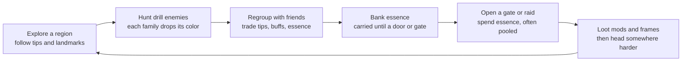
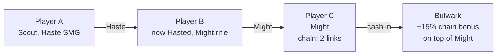

# Friendly Person Shooter — Game Design Document

Started Oct 30, 2026.

## Vision and pillars

Friendly Person Shooter is a co-op PvE FPS for a group of friends, where every bullet is a tool: hit an enemy and it debuffs, hit a friend and it buffs. The world is full of enemies built like aim-trainer drills. Progress is gated by colored resources that you find faster when friends split up and share what they find.

**Elevator pitch:** a hard shooter where the best thing that can happen to you is a friend showing up.

**Design pillars**

1. **Every bullet helps someone.** No shot is wasted. Missed enemies are practice; hit allies are gifts. Supporting a moving teammate is itself an aim challenge.
2. **Friends are good news.** Information, buffs and shared kills make every friend in the game worth having nearby. Nothing a friend can do makes your run worse.
3. **Hard, honest aim.** Difficulty comes from hitting targets, not from unfair damage or hidden stats. Gear and levels help a little, but skill decides.
4. **Nothing to win against others.** No PvP, no market, no ranked ladder. With no one to beat, cheating has little to gain (see Anti-cheat by design).

**Scope decisions**

- Indie scope: one player hosts and up to 7 friends join with a code, for 8 players at most. No matchmaking, no dedicated servers, and different groups never share a world.
- PC with mouse and keyboard only at launch.
- Built in Unity with Netcode for Entities. The host's game is the server; friends connect through Unity Relay.
- Placeholder art for now. Setting, tone and business model are still open.
- When the hard-aim and friends pillars conflict, the friends pillar wins: any friend who joins should be able to help.

## Core loop

A session is an expedition of about 20–40 minutes: head out, hunt drills for the color you need, split up and swap tips with your friends, then spend essence to open a harder region or raid.

Friends help at every step:

- **Explore:** friends split up to scout, and a tip ("purple's past the Broken Tower") saves minutes of searching.
- **Hunt:** chains clear enemies faster, and shared drops mean no one competes for kills.
- **Bank:** players who find your dropped cache send it back to you.
- **Open:** raid keys need several colors, so groups pool essence.

## Enemies as aim drills

Each enemy family trains one aim skill and drops one essence color. That means a region's color tells you which skill it will test, and needing a color pushes you to practice a skill you may be avoiding.

| Family | Aim skill | Behavior | Weak point | Essence |
| --- | --- | --- | --- | --- |
| Wisp | Flicking | Blinks between points; can be hit for a short window after each blink | Whole body, small | Yellow |
| Skitter | Tracking | Fast, erratic strafing along the ground | Glowing core | Red |
| Mite swarm | Target switching | Packs of 8–20 tiny targets; each dies in one hit | None | Green |
| Sentinel | Long-range precision | Stands far off, opens a head-sized eye briefly before firing | Eye | Blue |
| Bulwark | Timing and patience | Armored shell; the weak plate rotates or opens on a rhythm | Rotating plate | Purple |
| Diver | Vertical tracking | Circles overhead, then dives at you | Wings | Orange |
| Glimmer | Quick flicks | Small, short-lived target that pops up near players; never attacks; dies to one shot | Whole body, small | 25% chance of 1 random essence |

**Glimmers** keep you shooting between fights. They appear often and die to any single hit. Each kill has a 25% chance to drop 1 essence of a random color (Yellow, Red or Green), so they're a small bonus, never a reliable source of any color.

**Difficulty tiers.** Each family has tiers that scale hitbox size, speed, pattern randomness and how long the weak point stays open. The tier is the layer's number. Tier 2 is 88% size, 115% speed and 85% open time; tier 3 is 76%, 130% and 70%. Health and damage stay the same, so deeper enemies are harder to hit, not harder to survive. Elites combine two families (a Skitter that blinks, a Bulwark guarded by Mites), so higher regions test mixed skills.

- **Elites** have 2.5× health, are 1.2× bigger and wear a gold crown. They drop 3× their main color plus 1 of the second family's color, and give double kill XP. One of a spawn group can be an elite (6% of groups on layer 1, 20% on layer 2, 30% on layer 3).
- **The four elites:** Blinker (a Skitter that blinks like a Wisp), Guarded (a Bulwark with a Mite swarm), Soaring (a Sentinel that circles 7 m up) and Phasing (a Diver that blinks between circling points). Wisps and Mites have no elite.
- **Bulwarks also live in the open world.** They're smaller than the raid boss and hover in one spot, turning and firing. The plate opens for 2.2 s after 3.5 s shut, and the shell takes 20% damage.
- **Sentinels** turn to face their target. The eye opens for 1.2 s (less on higher tiers) before each bolt. The body takes 30% damage, and the eye is the weak point.
- **Divers** circle 10 m up for 3.5–5.5 s, warn for 0.7 s, then dive at 20 m/s and strike for 10 damage. The wings are the weak point, and they climb back up after a dive.

**Enemy design rules**

- Every attack is telegraphed by sound and light. Damage to players is moderate; the challenge is landing hits, not surviving surprises.
- Ranged attacks are slow glowing bolts you can see coming and sidestep, never instant hits. Enemies attack only what they can see: terrain, structures, tree canopies and big shrubs block both their sight and their bolts, so cover works. (Second playtest: Wisps hit instantly and shot through hills and plants.)
- Damage you take is always readable: a screen-edge marker points to the attacker, the screen flashes, a hurt sound plays, and an attacker you can't see is named. (First playtest: players couldn't tell what was hurting them.)
- Hitboxes match the visible model. No hidden hit zones.
- Enemies don't belong to whoever hit first. Everyone who lands a hit gets the full drop, so there is no kill stealing.
- Buffing counts as hitting. For 8 seconds after you land a payload buff on someone, every enemy they hit counts as yours too, for drops and kill XP. Supports earn as they help. A plain bullet with no payload doesn't count.
- Each family has a distinct silhouette and sound, so players can describe them to each other ("lots of Wisps by the river").

## Resources: essence

Essence comes in six colors, one per enemy family, and its main use is opening gates. Because each region leans toward one or two colors and the layout changes with each world seed, knowing where a color is matters more than raw killing speed.

**Where it comes from**

- Normal enemies drop small amounts of their color. Elites drop more, plus a little of both colors they combine.
- **Blooms** are temporary events where one color spawns heavily in one spot for a few minutes. More players at a bloom means more chains and faster clears, so players want to share where blooms are.
- Each zone shows a rough color bias on your map once you or someone you shared sightings with has visited it this seed. Exact spawn spots are found by playing or by asking.

**Carried vs. banked**

- Essence you pick up is *carried* until you bank it at a **raid door** or a **gate** (stand by one). Shrines don't bank: they're where you respawn and where Reset position takes you, so banking there would make a reset a free trip home. After a Reset position you can't bank for 60 seconds. At the open raid door, Red and Green go to the raid key first if it needs them.
- Banked essence goes into your **party's shared bank** (a party is a group you've teamed up with): everyone in the party banks into it and spends from it. Carried essence and caches stay personal. A solo player's bank is their own.
- When you bleed out (see Downed and revive), half your carried essence drops as a **cache** where you fell. Any player who picks up your cache sends it back to you and gets a small kudos reward. Returning a friend's lost essence becomes a common good deed.

**What it's for**

- **Gates** to deeper regions cost one color in bulk (for example 40 Yellow). A party pays once from its shared bank, and every member gets access. An opening lasts 90 seconds; then the gate shuts and the next opening costs 20 more (40, 60, 80...), so the gate stays a goal instead of a door left open.
- **Raid keys** cost several colors at once (today 12 Blue + 8 Purple + 12 Green). One player rarely has the mix, so groups pool essence.
- **Attunement** (small, optional): spend essence to reroll a mod's secondary stat.

**Gifting, not trading.** Players can give essence to anyone nearby, for free, including players outside their party. There's no market, no currency and no way to ask for something in return inside the game. This keeps the economy social and gives bots and sellers nothing to sell.

## Bullet effects

Every gun has a **payload slot**. A payload mod in that slot gives the gun one payload, and each payload has two sides: a buff when it hits a player and a debuff when it hits an enemy. Bullets never damage players: without a payload, a hit on an ally heals a tiny amount and still counts toward reviving them. A healer is still shooting, and keeping a dodging teammate topped up is a tracking drill of its own.

| Payload | On an ally (buff) | On an enemy (debuff) |
| --- | --- | --- |
| Vigor | Heals; overflow becomes a small temporary shield; counts double on revive fragments | Wither: damage over time |
| Might | Their shots deal more damage | Expose: takes more damage from everyone |
| Haste | Faster movement and jumps | Slow: moves and turns slower |
| Frenzy | Faster fire rate and reload | Jam: attacks less often |
| Ward | Damage shield | Brittle: armor and shells weaken |
| Focus | Their hits count as weak-point hits more easily (slightly larger weak points, for them only) | Mark: weak points glow and grow for everyone |
| Relay | Their next shots also carry your payload, and count as a chain link | Tag: hits on this enemy splash a little to nearby enemies |

**Rules**

- **No self-buffing.** Your payload only buffs other players. This is the core reason to want company. (A weak self-share mod exists for solo play; see Guns, mods and builds.)
- **Three buff slots per player.** A fourth buff replaces the oldest. This keeps the screen readable and stops one player from stacking everything.
- **Same buff from two sources** refreshes the duration and adds 50% of the second source's strength, capped at 2x a single source.
- **Short durations** (around 4–8 seconds) so support is an ongoing job, not a one-time cast.
- **Opt-out.** Players can set buffs to accept from Everyone, Party only, or No one, so an unwanted Haste can't throw anyone off a ledge.
- **Readability.** Essence already uses color, so payloads are identified by bullet shape, trail pattern and sound, with color as a secondary cue. Each payload has its own shot sound, varied in pitch and volume on every shot so it never grates.
- **Player colors.** Each player has a color for their body and their name in the team list, chat and minimap. Player colors avoid the six essence hues where possible.
- **Damage numbers.** Every hit on an enemy shows its damage; weak-point hits look different.

## Chains and combos

Buffs passed from player to player build a **chain**, and the last player's hit on an enemy cashes it in for bonus damage. This turns a group of friends into a firing line where everyone contributes, even players who never deal damage themselves.

A hastes B; B, now hasted, shoots C with Might; C's next hit on the Bulwark cashes a 2-link chain. Chain bonus on the cashing hit: 2 links +15%, 3 links +35%, 4 links +60% (cap).

**Chain rules**

- A chain starts when one player buffs another. Each time a buffed player buffs someone new within 5 seconds, the chain grows by one link.
- Each player counts once per chain, so A → B → A loops add nothing.
- The chain is cashed by the last player's next enemy hit within 5 seconds. Weak-point hits cash it for 1.5x the bonus, so the damage player still needs good aim.
- Chains cap at 4 links (+60%). The Conductor mod adds a link when you start a chain, but the cap still applies.
- Raids and Deeps are tuned around 2–3 link chains; the Wilds never require them.
- **Counting links:** links = players in the chain minus one, so A → B is 1 link (no bonus yet) and A → B → C is 2. A shot carried by Relay adds one more link, once per chain. With four players, the 4-link cap needs Relay or Conductor.
- Buffs don't travel along the chain: in the example C gets B's Might, not A's Haste.
- A player holds one chain at a time; if they're handed a second, they keep the longer one.

**Combos.** When two specific buffs sit on one player, or two debuffs on one enemy, they trigger a stronger effect. The game doesn't list combos until someone discovers them in your game, which gives players something else to share.

| Combo | Ingredients | Effect |
| --- | --- | --- |
| Overdrive | Haste + Frenzy (ally) | No reloads for the buff's duration |
| Deadeye | Might + Focus (ally) | Weak-point hits deal 3x instead of the normal bonus |
| Bastion | Vigor + Ward (ally) | Shield regenerates while both last |
| Pinned | Slow + Mark (enemy) | Enemy freezes for 1 second, a free shot for everyone |
| Shatter | Expose + Brittle (enemy) | Armor and shells break outright |
| Plague | Wither + Tag (enemy) | Damage over time spreads to nearby enemies |
| Blitz | Haste + Might (ally) | Might's damage bonus doubles while both last |

All seven combos are built. Plague spreads a Wither at 75% strength to enemies within 4 m every second. Overdrive keeps the magazine full and ends a reload at once. Deadeye makes weak-point hits deal 3×. Bastion regenerates the Ward at 8 a second, up to one Ward (20). Pinned freezes the enemy for 1 s when the combo forms (moving and attacking), not on every hit. Shatter makes armor take full damage.

Built numbers for the new payloads: Frenzy is +30% fire rate and reload speed for 6 s; Jam slows an enemy's attacks to 1/1.6 of normal. Ward is a 20-point shield for 6 s that soaks damage after Vigor's shield; the same giver tops a drained Ward back up. Brittle closes half the gap between an armor's damage and full damage. Focus grows the ally's weak points by 35%; Mark grows the enemy's by 40% for everyone. Every new payload has a mod, a shot sound and a HUD line.

## Downed and revive

Reviving a downed player is itself an aim drill that anyone can do, and more helpers make it faster. When a player goes down, bits of their soul burst out, and other players shoot them down to bring the player back.

- **Bleed-out:** a downed player has about 30 seconds before they respawn at the nearest shrine and drop half their carried essence as a cache. The other half stays carried.
- **Soul fragments** burst out in waves and fly in arcs and zigzags around the body, mixing flick and tracking targets. They're faster and smaller on deeper layers.
- **Revive:** hit about 8 fragments before bleed-out ends. Any player's bullets count, whatever the payload, and hits from several players add to the same total. A Vigor hit counts as 2.
- **No hard fail:** fragments nobody hits just fade while new waves keep coming. The only way to fail is running out of time.
- **No self-revive:** the downed player can't shoot their own fragments, but they can look around and quick-chat ("Need a res!").

Exact counts, timers and speeds get tuned in playtests.

## Guns, mods and builds

Guns are found, not chosen: each gun is a **frame** (how it fires) with three **mod slots** (how well it does it) and one **payload slot** (what its hits do to allies and enemies). Every gun damages enemies. Players carry two guns and swap with Q.

**Frames**

| Frame | Fires | Best against | Support use |
| --- | --- | --- | --- |
| Pistol | Accurate semi-auto | Wisps, Sentinels up close | Quick top-ups |
| Rifle | Accurate three-round bursts | All-rounder | Reliable buffs at mid range |
| SMG | Fast spray, falls off with range | Mites, Skitters | Keeps buffs up on a nearby ally |
| Marksman | Slow, high-damage single shots; zooms | Sentinels, Bulwarks | Big buff per hit, hard to land on a moving ally |
| Beam | Continuous; effect builds while on target | Skitters, Divers | Steady healing or shielding; pure tracking |
| Launcher | Slow projectile with a wide splash (5.5 m) | Mite swarms | Buffs a cluster of allies at once |

Every frame has a magazine and a reload (R); reserve ammo is unlimited. Right mouse zooms, by an amount set by the frame and its scope mod.

**Mods**

- **Stat mods** go in the three mod slots and improve one thing: damage, spread, range, scope, magazine size, reload speed or fire rate.
- **Payload mods** (Vigor, Might, Haste, Relay, and later Frenzy, Ward and Focus) go only in the payload slot and give the gun that payload.
- **Special mods** are rare stat mods with an unusual effect:
    - **Split**: the payload slot holds two payload mods, each at 60% strength.
    - **Ricochet**: hits on an ally bounce once to the nearest other ally.
    - **Conductor**: adds one extra chain link when you start a chain (see Chains and combos).
    - **Self-share**: you get 20% of the buffs you give. Exists for solo play; worse than having a partner.
- Mods come in three tiers (common, rare, epic). An epic mod is about 30% better than a common one, so skill stays the main factor.

**Finding gear**

- **Starting gun.** A new player picks one of three starting guns, each with a common payload mod. The three never share a frame or a payload, so the choice is real. Bots get their role's kit instead.
- **Loot boxes** stand around every zone. Each player who opens a box gets their own offer of three items (guns or mods, no two of the same kind) and picks one, so nobody competes for loot. Each card shows what taking it would swap out. A player can leave the offer and come back: the box stays shut, with the same three inside, until they pick.
- **Bosses** drop gear for everyone who fought them; a raid clear lets each player pick one of three rare-or-better items.
- **Equip on the spot.** There is no inventory: picking up a gun replaces the gun in your hand, and picking up a mod puts it on your current gun (in an empty slot, else in place of the same kind of mod, else the weakest). Whatever you replace drops on the ground, where anyone can take it.
- **Starting kit:** one random gun with one random payload mod. The second gun slot starts empty.
- Gear lasts one session for now, like levels; it becomes account-bound once accounts are saved.

**Example builds**

| Build | Loadout | Job |
| --- | --- | --- |
| Medic | Vigor Beam + Ward pistol | Keeps the group alive; lives on tracking |
| Conductor | Relay rifle with Conductor + Haste pistol | Starts chains and sets up the damage player |
| Striker | Might Marksman with a scope and damage mods + Frenzy pistol | Receives buffs and turns them into weak-point damage |
| Controller | Split SMG with Haste and Relay | Spreads two buffs at once; good for weaker aimers |
| Scout | Haste SMG + Focus pistol | Moves fast, finds blooms, buffs whoever they meet |

## World and hosting

The world is a set of zone maps that wrap around at the edges, one map per difficulty layer, all built from a weekly seed so the host and every friend see the same terrain and spawns. Each game is one host's world: friends join it with a code, and different groups never meet.

**Layers, gates and raids**

1. **Layer 1 (tier 1).** Soloable. Each zone leans toward one or two essence colors.
2. **Layer 2 (tier 2).** Denser elites and mixed enemy families. Built for duos and small groups.
3. **Layer 3 (tier 3).** Hardest families, rarer blooms. Launch ships these 3 layers.

**Moving between layers (built).** The group moves together, so friends are never on different layers.

- Walking through the open gate on layer 1 or 2 starts a 10-second countdown for everyone, with a HUD line and a big number for the last 5 seconds. Then the whole group goes to the next layer's start.
- On layers 2 and 3, an **up-portal** (a stone ring with a blue beam) stands 12 m from the start. Stepping into it starts the same countdown back up, and the group lands just in front of the upper gate. That gate stays open to them for free, so they can go back down.
- Layer 3's gate ends the expedition.
- Moving can't start while a raid gathers, runs or celebrates. A countdown already going is called off if a raid starts.
- Each layer has its own map from the world seed, with its own enemies, gate, raid doors, loot boxes and Colossus. Carried essence, the party bank, the raid key, kudos and the run clock carry over. Dropped caches go back to their owners.
- Gate colors: 40 Yellow on layer 1, 40 Blue on layer 2, 40 Purple on layer 3.
- Layer 2 has more spawns and more zones mixing two colors. Layer 3 has only Skitters, Sentinels, Bulwarks and Divers, and half as many blooms.

- **Gates** sit in specific zones and lead down one layer. Access is paid in essence and resets with each reseed. A party pays once from its shared bank and every member gets access. A party can pass only once every member has access, so someone who joins later is covered by the shared bank or a gift. Going back up is always free, so experienced players can return and help newer ones.
- **Raids** are doors in the world. Once its key is fully pooled, anyone at the door presses E to start a short countdown, so the group goes when it's ready; whoever is standing at the door when it ends goes in together, party or not. Raids take 4–8 players, the boss scales to the group size. When the boss dies it blows apart, everyone inside is paid on the spot (XP and an item; raids never pay essence, and enemies inside drop none), and the group can stay up there to celebrate for up to 5 minutes; each player goes home through an exit portal whenever they like. After a wipe or a timeout everyone returns to the door's zone.
- **Several raid doors, one open at a time.** A layer has 4 raid doors by shrines, spread at least 150 m apart; the first stands near the start. Only one is open. Clearing its raid spends it: it goes dark, and the next door opens somewhere else, so the group travels to raid again. Once all four are spent they all come back except the one just cleared. A wipe or a timeout leaves the door open. Every door banks essence, open or dark.
- **A raid is a run, not one fight.** Each run strings together random rooms (puzzles and skill checks), then a boss, plus one run modifier, so no two runs play the same. Rooms need the group to work together without voice (the HUD and the room itself say what to do), reward shooting allies or accurate aim, and scale to the group. Failing a room costs time, never the run; solving one pays everyone inside and opens a portal to the next. The build order lives in `Docs/RaidDevPlan.md`.
- **World bosses** land in the open on a timer, near a landmark close to where players are. No key and no group needed: anyone who shows up can fight, and everyone who hits it is paid. A tall beam and a HUD line point everyone to it. A world boss fights differently from raid bosses: raid bosses test aim under pressure in a closed room, world bosses test movement in the open (dodging, jumping, using cover).

**Zones and generation**

- A zone takes about 3–5 minutes to walk across (tuned in playtests).
- **Zone shapes.** Zones tile the ground in a rhombitrihexagonal pattern: big hexagons, each ringed by squares on its edges and small triangles at its corners. The pattern repeats in a rhombus that wraps on both axes, so walking off one side brings you in on the other. Hexagons are the open fighting grounds; squares and triangles are shorter crossings between them, each with its own theme and color lean.
- Landmarks, shrines, spawn points and loot boxes scale with a zone's area (a square gets about 40% of a hexagon's, a triangle about 17%, at least one of each). New players start in a hexagon, and gates stand in hexagons far from the start.
- Neighboring zones meet at the same ground height all along their shared edge, so the seams don't show.
- Zones are stitched from hand-built tiles (ruins, rivers, towers, canyons) using the seed. Hand-built pieces keep the shooting spaces good; the seed changes their layout and color bias.
- Every zone has a few named **landmarks** ("the Broken Tower", "Twin Falls") so players can give directions: "purple's past the Broken Tower." The compass and quick-chat use these names.
- Every zone has a few **shrines** for respawning. Banking happens at the raid door and gates (every raid door banks, open or dark).
- **No dead ends.** Generation fills small pits so one step climbs out. If you still get stuck, **Reset position** in the Esc menu sends you to the nearest shrine (3-second cooldown). You keep your carried essence but can't bank it for 60 seconds.
- **No visible edge.** Fog and draw distance end inside the loaded neighbor zones, so players never see past what's loaded.
- Crossing into a new zone blends the sky's colors only, never its cloud pattern.
- Terrain, spawn points and blooms all follow from the seed and the clock. The host tracks live enemies, which spawn point each group belongs to, and dropped caches.
- **Enemies stay until they're killed.** About half of each zone's spawn points are in use on a layer (60% on layers 2 and 3). The first time players come near a zone, each fills with its own family. When a point's whole group is dead, it waits 2 minutes. After that, it refills with a new random enemy from the zone's color mix as soon as no player is within 100 m. Nothing appears in front of you, and nothing vanishes mid-fight.
- Bloom groups refill 20 s after they're cleared while the bloom runs. When it ends, survivors leave once nobody is within 100 m of them. Colossus adds do the same after 3 minutes.
- Enemies in the open world don't scale with player count, so every extra player nearby is pure help.

**Weekly reseed**

- Each week the world reseeds. Gate access resets. Gear, kudos and skill stats are permanent.
- A game that is already running keeps its seed until the host ends it.

**Hosting**

- One player hosts: their game runs the server, their own client and any bot allies. Up to 7 friends join through Unity Relay with a join code, so nobody opens ports.
- Each player's game loads only the zones around them, so friends can spread across the map.
- There are no dedicated servers, no matchmaking and no shared world between groups. If the host leaves, the game ends.

## Social design

The game makes every meeting between friends in the world either useful or harmless, never costly. Players can't hurt each other, can't steal kills, can't compete for loot, and nearly always have something to offer: a buff, a direction, or a few essence.

**Playing apart, together.** Friends often split up to cover more ground. Quick-chat, sightings and the minimap let them call each other over to a bloom, a gate or a downed friend.

**Talking without typing**

- **Quick-chat wheel** with essence and landmark words: "Seen any [Yellow]?", "[Purple] → past [Broken Tower]", "Need buffs", "Bloom here!". Messages reach every player nearby, grouped or not, and show in the reader's language. Your own lines show in your chat feed too.
- **Minimap.** A simple top-down map in the corner shows players in their player colors and enemies as small dots. Teammates beyond its range sit on its rim as small arrows pointing their way.
- **Pings.** Middle mouse pings what you point at: an enemy, or the ground or a wall. Everyone sees a marker in the pinger's color drawn over everything (pinned to the screen's edge when it's off screen) with its distance, a pillar of light at the spot and a diamond on the minimap, and hears a chirp. A ping lasts 8 s; a new one replaces your old one.
- **Sightings.** Seeing a cluster of enemies or a bloom drops a private map pin. Looking at another player and pressing *share* swaps pins with them.
- **Proximity voice** is optional.

**Teaming up**

- **Teaming up is opt-in:** players invite each other to a party; nothing forms automatically. Quick-chat already reaches everyone nearby, so players can coordinate without forming a party.
- A party shares one essence bank and pays for gates together (see Resources: essence).
- Several players can pledge essence toward a raid key at a raid door, so players who aren't in one party can still open a raid together.

**Kudos**

- After a meaningful interaction (gave a buff, gave essence, returned a cache, revived them, shared a sighting that led to drops) you can send that player kudos.
- One kudos per player per day, and only after a real interaction, to stop farming.
- Kudos unlock cosmetics and titles. They're the game's main status symbol, and they can only be earned by helping people.

**Anti-griefing**

- No player damage. Soft player collision, so no one can body-block a doorway.
- Buff acceptance toggle (Everyone / Party / No one).
- Mute in two clicks, and the host can kick a player.

## Anti-cheat by design

Cheating is pointless here because there is no one to beat and nothing to sell, and an aimbot skips the very thing the game is about. The design removes the usual reasons to cheat rather than relying only on detection.

| Usual reason to cheat | Why it doesn't apply |
| --- | --- |
| Beat other players | No PvP, no ranked ladder, no kill competition |
| Sell items or accounts | No market, no currency, gear and essence are account-bound (gifting only) |
| Show off status | The main status symbol is kudos, which only comes from helping people. Aimbots can't fake gratitude |
| Skip a grind | Rewards are mostly access; gear and levels add only a small, capped power bonus; the grind *is* the aim practice |
| Feel skilled | Personal drill stats show your real improvement over time; cheating makes them meaningless to you |

**What a cheater actually does to others:** very little, and some of it helps. An aimbotting medic lands every heal. The main harm is trivializing a shared raid, which only matters to that group.

**Still enforced on the server:** hit validation, movement speed, essence pickups and drop rates. The host's game is the server, so a modded client can't spoil the group's run (no teleporting to blooms, no conjuring essence to gift). There are no leaderboards to protect.

**Watch out for:** any future feature that ranks players (speedrun boards, raid clear times) brings back the reason to cheat. Keep such boards opt-in, separate and cosmetic-only.

## Progression and economy

Players progress on five tracks. Two of them (Arsenal and Level) add power, and they share one small cap.

| Track | What grows | Persists | Earned by |
| --- | --- | --- | --- |
| Access | Gates and raids opened | Resets each weekly seed | Spending essence |
| Arsenal | Guns and mods | Per session for now; permanent once accounts are saved | Loot boxes, bosses, raids |
| Level | Level and skill points for a skill tree with three branches: Offense, Support, Survival | Per session for now; permanent once accounts are saved | XP from kills, buffs and heals on allies, banking essence, revives |
| Skill | Per-drill stats: flick time, tracking accuracy, switch speed, weak-point rate | Permanent | Playing |
| Social | Kudos, titles, cosmetics | Permanent | Helping other players |

**Power budget.** Gear and levels together give at most about +40% over a new player's stats, so skill stays the main factor. Max level grants fewer skill points than the tree has ranks, so players choose and builds differ. Levels get about +20% and gear about +20%: a fully ranked skill adds 9–30% in its area (for example +12% damage, +9% fire rate, +21 health), and maxing all of Offense adds about +22% damage per second. Max level is 16, which gives 15 points for the tree's 27 ranks. Every level costs the same 300 XP, so levels come at a steady pace (about one every 3–4 minutes) and a player can reach the top skills of a branch in one session.

**Essence flow.** Essence enters from enemies and blooms and leaves mainly through gates and raid keys. The party bank pools essence but doesn't change these totals. Because Access resets weekly, essence never piles up into a permanent surplus.

**Mastery badges.** Each enemy family has mastery ranks based on Skill stats (for example "Wisp III: hit 500 Wisps within 0.3 seconds of a blink"). They're cosmetic and show what you're good at, which helps a group pick roles fast.

**Monetization (proposal).** Cosmetics only. Selling power or essence would break both the anti-cheat argument and the gifting economy.

## Risks and open questions

The biggest risk is group size: the design is at its best with several friends, and a player with no one online gets the least out of it.

| Risk | Why it matters | Mitigation |
| --- | --- | --- |
| Playing alone or with one friend | Most of the fun needs company | Layer 1 is soloable; bot allies can fill seats; the Self-share mod |
| Aim difficulty drives off casual players | Friends with mixed skill can't play together | Low tiers forgiving; Controller and Focus builds help weaker aimers; support roles still need aim but on friendly, cooperative targets |
| Chains become mandatory | Solo players feel shut out | Wilds tuned for solo; chains needed only for Deeps and raids; Self-share mod |
| Visual noise | Buffs, debuffs and essence colors compete for attention | Three buff slots; payloads use shape and sound; essence owns color |
| Friends play as solos side by side | Pillar 2 fails | Make information scarce (weekly seed, blooms), make chains and combos pay off, reward kudos |
| Levels turn into a power grind | Undercuts "skill decides" and adds a reason to cheat | Levels and gear share a capped power budget; the tree offers choices, not everything |
| Unwanted buffs as griefing | Haste near ledges, visual spam | Acceptance toggle; no knockback on buffs |

**Open questions**

- [x] Gate access resets with each weekly reseed (decided).
- [x] Focus stays, since the friends pillar wins over hard aim (decided).
- [x] Raids take 4–8 players, with the boss scaled to group size (decided).
- [x] PC, mouse and keyboard only at launch (decided).
- [ ] Setting and tone. Deferred; placeholder art for now.
- [ ] Business model. Deferred.
- [x] Netcode for Entities, chosen in the networking test (decided).
- [x] No shared world or matchmaking: one player hosts and up to 7 friends join (decided Nov 5, 2026; replaced lobbies that split and merge).
- [ ] Where does saved progress (gear, kudos, skill stats) live once accounts are saved: on each player's PC or in a small backend?
- [ ] Should the game survive the host leaving (host migration), or is ending it fine?
- [ ] Working title: keep "Friendly Person Shooter"?
- [x] Banked essence is shared within a party, and one gate payment covers the party (decided after the first playtest).
- [x] The party bank stays with the party when someone leaves; the leaver takes nothing (decided).
- [x] Levels and gear each get about +20% of the power budget (decided).
- [ ] Do Glimmers' random drops weaken "knowing where your color is"? Keep their yield small and watch it.

## Test bots

Bot allies let one developer test gameplay without organizing a playtest, and can fill empty seats in a small group. Each bot is a full client in the host's process that plays through the same network path as a human.

**What a bot does**

- Picks goals the way a player would: hunt a needed color, go to a bloom, bank at a gate or the raid door.
- Shoots enemies, buffs nearby players (human or bot), starts chains, shoots revive fragments, and pledges essence at gates and raid doors.
- Says quick-chat lines (calls for a res, says thanks).
- Aims with adjustable reaction time, tracking error and flick overshoot, so bots can stand in for strong and weak aimers.

**Behavior profiles**

| Profile | Plays like |
| --- | --- |
| Medic | Vigor: shoots a downed ally's fragments, heals the most hurt, keeps buffs up, then shoots enemies |
| Haste | Support: buffs allies now and then and grows the chains it holds |
| Might | Damage: shoots enemies, cashing any chain it holds, and sometimes buffs |

The menu's solo and host games add up to 3 bots; the command line sets how many and how many are Medics.

## MVP scope and prototype plan

Tackle the riskiest part first: networking, proven with test bots before any gameplay depends on it. Next, prove that shooting allies to buff them is fun and that chains feel great. The full world and raids come after that.

1. **Networking.** Choose the netcode library and prove it with bots on a wrapping grid. (This step originally built lobbies that split and merge; that design was dropped on Nov 5, 2026 for host and join.)
    - Pass if: the game holds a smooth tick rate with bots and stays playable on a laggy link.
2. **Shooting feel.** One arena, three families (Wisp, Skitter, Mite swarm), two payloads (Vigor, Might), built on the step 1 network layer. Test with bot allies that move like players.
    - Pass if: healing a moving bot feels like a skill, not a chore.
3. **Chains and revives.** 4-player online co-op; add Haste and Relay, the chain bonus, two combos and the soul-fragment revive. Add the Medic bot profile.
    - Pass if: testers start coordinating chains without being told to, and reviving feels like a fun drill.
4. **First layer and gate.** A generated layer-1 grid with landmarks, one essence color, shrines, caches and one gate.
    - Pass if: a 20-minute session has a clear goal and ending.
5. **Talking and helping.** Quick-chat to everyone nearby, sightings and kudos.
    - Pass if: in playtests, friends who split up keep calling each other over and trading info, buffs, revives or essence.
6. **First raid.** One raid door for 4–8 players with a multi-color key.
    - Pass if: a group can clear it with quick-chat only.

### Prototype status (November 2026)

Steps 1–4 are built and pass their bot-only checks; steps 5 and 6 are built. Each step still needs its human playtest.

| Step | Built | Measured with bots |
| --- | --- | --- |
| 1. Networking | Netcode for Entities (chosen); host and join over Unity Relay with a join code. The earlier lobby split-and-merge system and its bot population were removed on Nov 5, 2026 | 150 bots + 20 on a laggy link held a 60 fps server (measured on the old lobby test) |
| 2. Shooting feel | Arena with Wisps, Skitters and a Mite swarm; Vigor and Might; lag-compensated hitscan; bot allies that strafe and jump | Healing matters: with no healer bots go down 4 times in 90 s |
| 3. Chains and revives | Haste and Relay, chains with the bonus, Plague and Blitz combos, soul-fragment revive, Medic bot | Bots cash 2-link chains, form combos and revive downed allies (8 fragment hits in about 20 s), also on a 150 ms link |
| 4. First layer and gate | Expedition mode: generated wrapping layer of zones (a 4x4 grid of 250 m squares at first, a rhombitrihexagonal tiling since Nov 5, 2026), landmarks, shrines, seeded spawns and blooms, essence, caches, one 40-Yellow gate, objective HUD with a light beam | A Might bot hunted 40 Yellow, banked it and passed the gate in 14:21; a Haste bot that mostly buffed earned only 9 |
| 5. Talking and helping | Quick-chat (fixed lines with color and landmark slots, 60 m earshot, rate limits), kudos with anti-farming rules, encounter-exchange measurement. Sightings and shared map knowledge exist in Core with tests but are not in the game yet | Quick-chat and kudos are wired into the expedition: number keys say lines, K gives kudos, bots call for a res and say thanks. The real check needs several humans |
| 6. First raid | A raid door near the start shrine with a 20 Red + 12 Green key pledged from carried or banked essence; with the key full, anyone at the door presses E to start a 20 s countdown, then whoever stands at the door goes in (up to 8); a floating arena; the Bulwark boss (health scales per player, armored shell, a turning plate that opens for full damage, add waves at 75/50/25%); clear gives 300 XP and 10 Yellow; wipe, timeout (8 min) and reset | 4 bots cleared it in 2:40 with one down and a revive; 1 player alone wiped in 22 s. Bots don't yet gather Red and Green or answer the gather call; a bot at the door presses E once a full key has waited 30 s, so people normally choose when to go |

**First human playtest (Nov 3, 2026).** Friends played a hosted build over Relay. Fixed right after: a HUD in place of the debug text (help moved to the Esc menu), Reset position, player colors, per-payload shot sounds, and the sky that seemed to spin when crossing zones. Added next: party-shared bank, clearer damage taken, your own quick-chat in the feed, a player-only minimap, levels with a skill tree, damage numbers, Glimmers, filled pits, and no view past the loaded zones.

**Guns (built Nov 4, 2026; not yet playtested).** The found-gun system from the Guns section replaces the single rifle and the Q payload cycle. It has all six frames (Pistol, burst Rifle, SMG, Marksman, Beam and a Launcher whose shells burst on landing), 3 mod slots plus a payload slot, and stat, special and payload mods in three tiers. Everyone starts with one random gun with one random payload mod, and bots get their role's payload. Q swaps guns, R reloads, right mouse zooms, and E opens a loot box or takes an item. Shift sprints at 1.5× speed while moving forward and not zoomed, with no stamina. Each zone has 9 boxes (3 before the second playtest), and every player gets their own roll from each box once. A raid clear offers each raider three rare-or-better items to pick one from. A swapped-out item stays on the ground for 2 minutes for anyone to take. Checked in the Editor with bots: every frame fires, and boxes, pickups, swaps and drops work.

**Avatars (built Nov 4, 2026; not yet playtested).** Players are goofy floating robots in the zones' low-poly style, based on a legless hovering robot with a visor face. Each player gets a random robot when they join: head (ball, box, can or bean), ears (cat ears, antenna, propeller, bunny ears, headphones or twin antennae), eyes (a mismatched pair, one huge eye, three eyes or googly eyes), mouth, body (egg, barrel, cone or ball), a short or springy neck, one or two thrusters, and big mitts or three-fingered hands. Shells are mostly white; the chest plate, cuffs and ears use the player's team colour. Robots bob, lean into movement and wobble their heads. Their floating hands hold the gun on its grip and fore-end, and tracers leave from the gun's muzzle. You see your own hands on your gun. Downed robots lie on their backs.

**After the first playtest (built Nov 4, 2026; not yet playtested).**
- **Gate:** it no longer stays open forever. Paying opens it for the whole party for 90 seconds, then it shuts and the next opening costs 20 Yellow more. Players who went through start a new run toward the pricier opening.
- **All three colors:** the layer had still been using the MVP's Yellow-only setting, so no Skitters or Mites spawned in the world. Zones now lean toward Yellow, Red or Green, as the design says.
- **HUD:** the HUD shows carried and banked amounts for Yellow, Red and Green on one line.
- **The Colossus:** the first world boss.
  - It first lands 4 minutes in, then 8 minutes after each kill, on open ground about 30 m from a landmark 90–320 m from a player.
  - Health is 1.5× the raid Bulwark's for at least 3 players.
  - It calls Skitters and Mites at 75%, 50% and 25%.
  - Everyone who hits it gets 12 Yellow, 12 Red and 12 Green, 300 XP and a pick of three rare-or-better items.
  - An orange beam and a HUD line show where it is and its health.

**After the second playtest (built Nov 4, 2026; not yet playtested).**
- **Dodgeable attacks:** Wisps, Skitters and bosses fire slow glowing bolts (16–22 m/s) aimed where you stood, so sidestepping beats them. Mites still bite up close.
- **Cover:** enemies need line of sight to attack. Terrain, structures, tree canopies and shrubs taller than 1.1 m block sight and bolts. Plants don't block players or player bullets.
- **The Colossus fights differently from the raid Bulwark.** It is a floating gem 12 m across with six armor petals and a crystal core on top.
  - While it hovers it takes 1/5 damage and fires 3-bolt fans at the nearest player it can see every 2.4 s.
  - Every 9 s it rises and slams down, sending a ground shockwave out to 36 m. Jump over the ring or take 22 damage.
  - After the slam it is stunned for 5 s: the petals open, it takes full damage and the gold core is a weak point. The HUD says when to dodge, jump and shoot.
- **Loot boxes:** 9 per zone instead of 3 (since the tiling switch: 9 per hexagon, fewer in smaller zones).
- **Red and Green enemies:** they were spawning, but the dark red Skitters and tiny Mites were hard to spot. Both now glow, Mites are bigger, and the minimap shows enemies as dots in their essence color.

**Raid runs, phase 1 (built Nov 5, 2026; not yet playtested).** A raid is now 3 random rooms from a pool of 4 (8 since phase 3), then the Bulwark, in 12 minutes (was 8).
- **Color Locks** (puzzle): an altar shows an order of Yellow, Red and Green crystals (3, 4, then 5 long; one longer for 6+ players). Shoot them in order, each hit by a different player than the last, at most 6 s apart. A wrong crystal or a pause starts the round over. Skitters climb on every 30 s.
- **Hold the Plates** (puzzle): about half the group (1–4 plates) stands on every lit plate at once for 25 s. The bar drains slowly while any plate is empty, and Skitters and Mites come every 14 s.
- **Sweeper Gauntlet** (skill): 12 stepping stones about 2 m apart over the void, with low turning arms on four of them. Jump the arms (6 damage) and the gaps (a fall sends you back to the start, 5 damage). Gauntlet damage never takes anyone below 10 health. Everyone up must stand on the far pad.
- **Wisp Storm** (skill): kill 8 + 2 per player Wisps in 90 s. The storm's Wisps don't shoot back; running out of time starts the count over.
- **Portals:** a solved room pays everyone inside 75 XP and 3 Yellow and opens a portal. When someone steps in, everyone moves on 5 s later, the downed get up, and everyone is healed.
- **Modifiers** (one per run): Swarming (twice the adds; the storm needs 4 more kills), Swift Bolts (enemy bolts 40% faster), Brittle (players take 30% more damage; rooms pay 50% more XP).
- Checked in the Editor with 3 bots, which solve every room on their own (gauntlet 25 s, plates 27 s, Color Locks 13 s, storm 67 s) and reach the Bulwark; they wiped at about 25% boss health, so the boss clear waits for the playtest. The storm was made easier (and its Wisps passive) after bots kept failing it while being shot. Standing on a sweeper's pivot always gets you hit, so cross beside it.

**Raid runs, phase 2 (built Nov 5, 2026; not yet playtested).** The room pool grows to 6, the boss is rolled per run, and every room gets a new shape each run.
- **Echo Runes** (puzzle): a wall splits the room into two halves, each with a slab of 4 runes. Each slab flashes its own sequence (3, 4, then 5 long; one longer for 6+ players), so the group splits up. Shoot your slab's runes back in order. A wrong rune, or 9 s without a hit, replays that slab's show. Both slabs finish 3 rounds to solve it. Skitters climb on every 26 s.
- **Hold the Core** (skill): keep a crystal core alive for 60 s. Every 7 s Skitters run at it from three gates (one per gate at 4 players, more for bigger groups; Swarming adds half again). Each one that reaches it bursts for 10 of its 100 health. If the core breaks, the hold starts over.
- **The Twins** (boss, a third of runs since phase 3): two Bulwarks, each with 60% of the single boss's health, standing 16 m apart. When one falls, the other must follow within 10 s or the first comes back at half health. Add waves follow their combined health. The HUD shows both bars and the revive countdown.
- **Layout variants:** each run reshapes its rooms from a seed: where the Color Locks pillars and plates stand, which gauntlet stones sweep and how fast, the rune patterns, and the core's gates and cover. Floors, spawns and portals stay put.
- Checked in the Editor with 3 bots: Echo Runes takes about 30 s with no mistakes. Bots struggle to hold the core (they let about half the runners through) and reach a third of the Twins' health before wiping, so both need the playtest.

**After the third playtest (built Nov 6, 2026; not yet playtested).**
- **Menu fix:** the build started in the Expedition scene behind the main menu (a broken screen) since the lobby code was removed on Nov 5. It starts at the menu again.
- **Starting gun pick:** three cards over a dimmed screen; the mouse stays free until you pick one. Taking loot before picking keeps what you hold.
- **Raid ending:** the boss explodes (a fireball, a shockwave along the floor, flying armor and a flash of light), rewards land right away, and an exit portal opens on the boss platform. Bots hang about for 15 s, then leave through it. The raid ends when the last raider has gone home, or after 5 minutes.
- **Pings and minimap arrows** (see Talking without typing).
- **Launcher:** splash radius 3.5 m → 5.5 m.
- **Raids pay no essence:** rooms pay 75 XP (no Yellow), the clear pays 300 XP and an item (no Yellow), and enemies killed inside a raid drop no essence.
- **Raid doors move:** 4 doors per layer, one open at a time; a clear spends the door (drawn dark, with a HUD line pointing at the open one) and opens the next. The raid platforms stay above the first door.
- **Loot box picks:** a box offers three items on the same pick screen as the starting gun, and the picked one is equipped at once (what it replaces drops at your feet). E, Esc, the Leave button, walking 6 m away or going down leaves the offer for later. Boss rewards (a raid clear, the Colossus) use the same screen: three rare-or-better items, one must be taken, and the screen waits until any other pick is closed. Bots keep their role's kit.
- Checked in the Editor with 3 bots: the pick, a ping on the terrain, rim arrows for two bots sent 200–250 m away, and two won raids (the Weaver and the Bulwark) with the explosion, the hang-out and the exit portal.

**Raid runs, phase 3 (built Nov 5, 2026; not yet playtested).** Two strange rooms (8 in the pool), a third boss, and two more run modifiers.
- **Lanterns** (puzzle): the room is nearly dark. A helpful payload hit on an ally makes them glow for 10 s (a lone player always glows), with a light that reaches 7.5 m. Shades (Skitters) can only be hurt inside someone's light; hits in the dark do nothing and show a refused marker. Kill 6 + 2 per player. Shades trickle in one at a time up to a cap.
- **Sentinel Eye** (skill): a shell 7 m up turns slowly. An eye warns (orange) for 0.6 s, then opens for 0.8 s at a random spot, at least 3 steps around from the last. The shell blocks shots, so you hit the eye only from its side. Hit it 6 + 1 per player times. The shell fires a bolt (8 damage) at someone in sight every 2.4 s, and low walls give cover.
- **The Weaver** (boss): the Bulwark's plate fight on a floor of 64 tiles. From 8 s in, a tile cracks (shakes and glows orange) every 2.5 s and falls 3 s later; once 30 are gone the oldest hole comes back. The 4 pillar rows never fall. Falling through puts you back on the nearest safe tile for 12 damage. Every 15 s the Weaver ties threads between pairs of players (the odd one out to itself), up to 4. Each thread shields it (it takes 1/4 damage while any is up) and snaps after 10 s for 25 damage to both ends. Shoot a thread 4 times to cut it, but not your own unless you're alone, so others have to free you. No add waves.
- **Low Gravity** (modifier): half gravity inside the raid, so jumps go higher and float. **Fog** (modifier): grey fog closes in from 6 to 34 m.
- Checked in the Editor with 3 bots: Lanterns solved in 32 s, Sentinel Eye (with Fog) in 59 s, and the Low Gravity gauntlet crossed with no falls. Against the Weaver (Low Gravity) the bots cut 16 of 18 threads and dealt about 73% before wiping, close to the other bosses, so its clear is left to the playtest.

**Zone tiling (built Nov 5, 2026; not yet playtested).** The square 4x4 grid of 250 m zones is replaced by a wrapping rhombitrihexagonal tiling of 54 zones: 9 hexagons (250 m tall), 27 squares and 18 triangles, about 1 km across. Zones are named like "2.1" (a hexagon) and "2.1a" to "2.1e" (its squares and triangles). Features and loot boxes scale with zone area, players start in a hexagon, and the gate stands in a far hexagon. The generated ground follows each zone's outline and meets its neighbors exactly at the border height. Zones load around you by distance instead of by grid neighbor, and bot pathfinding follows paths across the wrap.

**All enemies, six payloads and three layers (built Nov 8, 2026; not yet playtested).**
- **Enemies and essence:** Sentinels (Blue), Divers (Orange) and smaller Bulwarks (Purple) spawn in the open world. Elites and tiers 1 to 3 are in. The HUD shows all six colors and the layer number. The raid key is now 12 Blue + 8 Purple + 12 Green.
- **Payloads and combos:** Frenzy, Ward and Focus are in, with all seven combos. Enemies show markers for Jam, Brittle, Mark, Pinned (an ice shell) and Shatter.
- **Layers 2 and 3:** see Moving between layers.
- Checked in the Editor with a bot: every new family spawns, moves, attacks and is drawn. Bots kill elites. Pinned, Shatter, Jam, Overdrive and Frenzy work on the host and show on the client. The group went down through the gate to layer 2, back up through the portal, and through layer 3's gate to the end. 379 Core tests pass.
- Not built: Attunement and the weekly reseed.

**No more spawn waves (Nov 9, 2026; not yet playtested).** Open-world enemies used to belong to 60-second waves: when a wave ended, every survivor vanished and new enemies rolled in, even mid-fight. Now they stay until killed, and a cleared spawn point refills after 2 minutes with a new random enemy, once no player is within 100 m (see the world rules above). The wave code also had a bug: a spawn point skipped a wave when another zone's point with the same number had already spawned in it, so the world now holds more enemies than before (103 near the start instead of 46 in the same test). Checked in the Editor: no enemy vanished over 2 minutes, a cleared point stayed empty 2 minutes later with the player 30 m away, and refilled (as a Sentinel) as soon as the player moved 150 m away. 382 Core tests pass.

**Open questions from the prototype**

- Under 150 ms of latency, bots land about half as many hits on moving targets. Lag compensation lines up, so this comes from jittery interpolation. Humans should test whether it feels fair.
- Hexagon zones are 250 m across in the MVP (about 1 minute to cross), not the doc's 3–5 minutes, so a 20-minute run can reach the gate.

**Out of MVP:** weekly reseeds, layers 2 and 3, all six families, the full mod pool, mastery badges, voice chat.
