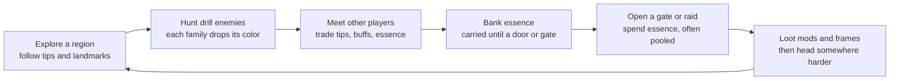
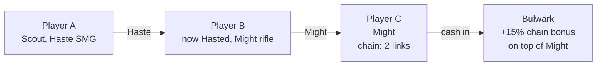
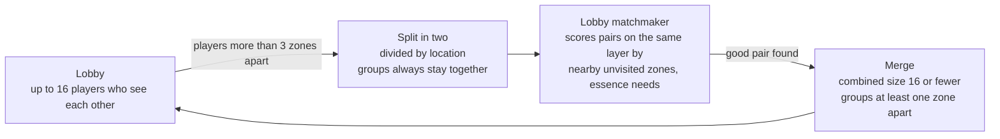

# Friendly Person Shooter — Game Design Document

Started Oct 30, 2026. Live version: https://claude.ai/artifact/N9umHWYERk8GxVuEND16gu (this file is a snapshot; keep the two in sync).

## Vision and pillars

Friendly Person Shooter is a co-op PvE FPS where every bullet is a tool: hit an enemy and it debuffs, hit a player and it buffs. The world is full of enemies built like aim-trainer drills. Progress is gated by colored resources that you find faster by talking to strangers.

**Elevator pitch:** a hard shooter where the best thing that can happen to you is running into another player.

**Design pillars**

1. **Every bullet helps someone.** No shot is wasted. Missed enemies are practice; hit allies are gifts. Supporting a moving teammate is itself an aim challenge.
2. **Strangers are good news.** Information, buffs and shared kills all make other players worth meeting. Nothing a stranger can do makes your run worse.
3. **Hard, honest aim.** Difficulty comes from hitting targets, not from unfair damage or hidden stats. Gear and levels help a little, but skill decides.
4. **Nothing to win against others.** No PvP, no market, no ranked ladder. With no one to beat, cheating has little to gain (see Anti-cheat by design).

**Scope decisions**

- Indie scope: small lobbies of up to 16 players that split and merge, not a large-shard MMO.
- PC with mouse and keyboard only at launch.
- Built in Unity, with a server-authoritative netcode library chosen after the networking test.
- Placeholder art for now. Setting, tone and business model are still open.
- When the hard-aim and social pillars conflict, the social pillar wins: anyone who shows up should be able to help.

## Core loop

A session is an expedition of about 20–40 minutes: head out, hunt drills for the color you need, swap tips with players you meet, then spend essence to open a harder region or raid.

Other players help at every step:

- **Explore:** a stranger's tip ("purple's past the Broken Tower") saves minutes of searching.
- **Hunt:** chains clear enemies faster, and shared drops mean no one competes for kills.
- **Bank:** players who find your dropped cache send it back to you.
- **Open:** raid keys need several colors, so groups pool essence.

## Enemies as aim drills

Each enemy family trains one aim skill and drops one essence color. That means a region's color tells you which skill it will test, and needing a color pushes you to practice a skill you may be avoiding.

| Family | Aim skill | Behavior | Weak point | Essence |
| --- | --- | --- | --- | --- |
| Wisp | Flicking | Blinks between points; can be hit for a short window after each blink | Whole body, small | Yellow |
| Skitter | Tracking | Fast, erratic strafing along the ground | Glowing core | Red |
| Mite swarm | Target switching | Packs of 8–20 tiny targets; each dies in one hit | None | Green |
| Sentinel | Long-range precision | Stands far off, opens a head-sized eye briefly before firing | Eye | Blue |
| Bulwark | Timing and patience | Armored shell; the weak plate rotates or opens on a rhythm | Rotating plate | Purple |
| Diver | Vertical tracking | Circles overhead, then dives at you | Wings | Orange |
| Glimmer | Quick flicks | Small, short-lived target that pops up near players; never attacks; dies to one shot | Whole body, small | A little Yellow |

**Glimmers** keep you shooting between fights. They appear often, die to any single hit and drop about 1 Yellow each, so their yield stays small next to real Yellow hunting.

**Difficulty tiers.** Each family has tiers that scale hitbox size, speed, pattern randomness and how long the weak point stays open. Elites combine two families (a Skitter that blinks, a Bulwark guarded by Mites), so higher regions test mixed skills.

**Enemy design rules**

- Every attack is telegraphed by sound and light. Damage to players is moderate; the challenge is landing hits, not surviving surprises.
- Damage you take is always readable: a screen-edge marker points to the attacker, the screen flashes, a hurt sound plays, and an attacker you can't see is named. (First playtest: players couldn't tell what was hurting them.)
- Hitboxes match the visible model. No hidden hit zones.
- Enemies don't belong to whoever hit first. Everyone who lands a hit gets the full drop, so there is no kill stealing.
- Buffing counts as hitting. For 8 seconds after you land a payload buff on someone, every enemy they hit counts as yours too, for drops and kill XP. Supports earn as they help. A plain bullet with no payload doesn't count.
- Each family has a distinct silhouette and sound, so players can describe them to each other ("lots of Wisps by the river").

## Resources: essence

Essence comes in six colors, one per enemy family, and its main use is opening gates. Because each region leans toward one or two colors and the layout changes with each world seed, knowing where a color is matters more than raw killing speed.

**Where it comes from**

- Normal enemies drop small amounts of their color. Elites drop more, plus a little of both colors they combine.
- **Blooms** are temporary events where one color spawns heavily in one spot for a few minutes. More players at a bloom means more chains and faster clears, so players want to share where blooms are.
- Each zone shows a rough color bias on your map once you or someone you shared sightings with has visited it this seed. Exact spawn spots are found by playing or by asking.

**Carried vs. banked**

- Essence you pick up is *carried* until you bank it at the layer's **raid door** or a **gate** (stand by one). Shrines don't bank: they're where you respawn and where Reset position takes you, so banking there would make a reset a free trip home. After a Reset position you can't bank for 60 seconds. At the raid door, Red and Green go to the raid key first if it needs them.
- Banked essence goes into your **party's shared bank** (a party is a group you've teamed up with): everyone in the party banks into it and spends from it. Carried essence and caches stay personal. A solo player's bank is their own.
- When you bleed out (see Downed and revive), half your carried essence drops as a **cache** where you fell. Any player who picks up your cache sends it back to you and gets a small kudos reward. Returning a stranger's lost essence becomes a common good deed.

**What it's for**

- **Gates** to deeper regions cost one color in bulk (for example 40 Yellow). A party pays once from its shared bank, and every member gets access.
- **Raid keys** cost several colors at once (for example 30 Blue + 30 Purple + 20 Green). One player rarely has the mix, so groups pool essence.
- **Attunement** (small, optional): spend essence to reroll a mod's secondary stat.

**Gifting, not trading.** Players can give essence to anyone nearby, for free, including strangers outside their party. There's no market, no currency and no way to ask for something in return inside the game. This keeps the economy social and gives bots and sellers nothing to sell.

## Bullet effects

Every gun has a **payload slot**. A payload mod in that slot gives the gun one payload, and each payload has two sides: a buff when it hits a player and a debuff when it hits an enemy. Bullets never damage players: without a payload, a hit on an ally heals a tiny amount and still counts toward reviving them. A healer is still shooting, and keeping a dodging teammate topped up is a tracking drill of its own.

| Payload | On an ally (buff) | On an enemy (debuff) |
| --- | --- | --- |
| Vigor | Heals; overflow becomes a small temporary shield; counts double on revive fragments | Wither: damage over time |
| Might | Their shots deal more damage | Expose: takes more damage from everyone |
| Haste | Faster movement and jumps | Slow: moves and turns slower |
| Frenzy | Faster fire rate and reload | Jam: attacks less often |
| Ward | Damage shield | Brittle: armor and shells weaken |
| Focus | Their hits count as weak-point hits more easily (slightly larger weak points, for them only) | Mark: weak points glow and grow for everyone |
| Relay | Their next shots also carry your payload, and count as a chain link | Tag: hits on this enemy splash a little to nearby enemies |

**Rules**

- **No self-buffing.** Your payload only buffs other players. This is the core reason to want company. (A weak self-share mod exists for solo play; see Guns, mods and builds.)
- **Three buff slots per player.** A fourth buff replaces the oldest. This keeps the screen readable and stops one player from stacking everything.
- **Same buff from two sources** refreshes the duration and adds 50% of the second source's strength, capped at 2x a single source.
- **Short durations** (around 4–8 seconds) so support is an ongoing job, not a one-time cast.
- **Opt-out.** Players can set buffs to accept from Everyone, Party only, or No one, so an unwanted Haste can't throw anyone off a ledge.
- **Readability.** Essence already uses color, so payloads are identified by bullet shape, trail pattern and sound, with color as a secondary cue. Each payload has its own shot sound, varied in pitch and volume on every shot so it never grates.
- **Player colors.** Each player has a color for their body and their name in the team list, chat and minimap. Player colors avoid the six essence hues where possible.
- **Damage numbers.** Every hit on an enemy shows its damage; weak-point hits look different.

## Chains and combos

Buffs passed from player to player build a **chain**, and the last player's hit on an enemy cashes it in for bonus damage. This turns a few strangers into a firing line where everyone contributes, even players who never deal damage themselves.

A hastes B; B, now hasted, shoots C with Might; C's next hit on the Bulwark cashes a 2-link chain. Chain bonus on the cashing hit: 2 links +15%, 3 links +35%, 4 links +60% (cap).

**Chain rules**

- A chain starts when one player buffs another. Each time a buffed player buffs someone new within 5 seconds, the chain grows by one link.
- Each player counts once per chain, so A → B → A loops add nothing.
- The chain is cashed by the last player's next enemy hit within 5 seconds. Weak-point hits cash it for 1.5x the bonus, so the damage player still needs good aim.
- Chains cap at 4 links (+60%). The Conductor mod adds a link when you start a chain, but the cap still applies.
- Raids and Deeps are tuned around 2–3 link chains; the Wilds never require them.
- **Counting links:** links = players in the chain minus one, so A → B is 1 link (no bonus yet) and A → B → C is 2. A shot carried by Relay adds one more link, once per chain. With four players, the 4-link cap needs Relay or Conductor.
- Buffs don't travel along the chain: in the example C gets B's Might, not A's Haste.
- A player holds one chain at a time; if they're handed a second, they keep the longer one.

**Combos.** When two specific buffs sit on one player, or two debuffs on one enemy, they trigger a stronger effect. The game doesn't list combos until someone discovers them in your lobby, which gives players something else to share.

| Combo | Ingredients | Effect |
| --- | --- | --- |
| Overdrive | Haste + Frenzy (ally) | No reloads for the buff's duration |
| Deadeye | Might + Focus (ally) | Weak-point hits deal 3x instead of the normal bonus |
| Bastion | Vigor + Ward (ally) | Shield regenerates while both last |
| Pinned | Slow + Mark (enemy) | Enemy freezes for 1 second, a free shot for everyone |
| Shatter | Expose + Brittle (enemy) | Armor and shells break outright |
| Plague | Wither + Tag (enemy) | Damage over time spreads to nearby enemies |
| Blitz | Haste + Might (ally) | Might's damage bonus doubles while both last |

The prototype (MVP step 3) has Plague and Blitz, the two combos possible with Vigor, Might, Haste and Relay. Plague spreads a Wither at 75% strength to enemies within 4 m every second.

## Downed and revive

Reviving a downed player is itself an aim drill that anyone can do, and more helpers make it faster. When a player goes down, bits of their soul burst out, and other players shoot them down to bring the player back.

- **Bleed-out:** a downed player has about 30 seconds before they respawn at the nearest shrine and drop half their carried essence as a cache. The other half stays carried.
- **Soul fragments** burst out in waves and fly in arcs and zigzags around the body, mixing flick and tracking targets. They're faster and smaller on deeper layers.
- **Revive:** hit about 8 fragments before bleed-out ends. Any player's bullets count, whatever the payload, and hits from several players add to the same total. A Vigor hit counts as 2.
- **No hard fail:** fragments nobody hits just fade while new waves keep coming. The only way to fail is running out of time.
- **No self-revive:** the downed player can't shoot their own fragments, but they can look around and quick-chat ("Need a res!").

Exact counts, timers and speeds get tuned in playtests.

## Guns, mods and builds

Guns are found, not chosen: each gun is a **frame** (how it fires) with three **mod slots** (how well it does it) and one **payload slot** (what its hits do to allies and enemies). Every gun damages enemies. Players carry two guns and swap with Q.

**Frames**

| Frame | Fires | Best against | Support use |
| --- | --- | --- | --- |
| Pistol | Accurate semi-auto | Wisps, Sentinels up close | Quick top-ups |
| Rifle | Accurate three-round bursts | All-rounder | Reliable buffs at mid range |
| SMG | Fast spray, falls off with range | Mites, Skitters | Keeps buffs up on a nearby ally |
| Marksman | Slow, high-damage single shots; zooms | Sentinels, Bulwarks | Big buff per hit, hard to land on a moving ally |
| Beam | Continuous; effect builds while on target | Skitters, Divers | Steady healing or shielding; pure tracking |
| Launcher | Slow projectile with small splash | Mite swarms | Buffs a cluster of allies at once |

Every frame has a magazine and a reload (R); reserve ammo is unlimited. Right mouse zooms, by an amount set by the frame and its scope mod.

**Mods**

- **Stat mods** go in the three mod slots and improve one thing: damage, spread, range, scope, magazine size, reload speed or fire rate.
- **Payload mods** (Vigor, Might, Haste, Relay, and later Frenzy, Ward and Focus) go only in the payload slot and give the gun that payload.
- **Special mods** are rare stat mods with an unusual effect:
    - **Split**: the payload slot holds two payload mods, each at 60% strength.
    - **Ricochet**: hits on an ally bounce once to the nearest other ally.
    - **Conductor**: adds one extra chain link when you start a chain (see Chains and combos).
    - **Self-share**: you get 20% of the buffs you give. Exists for solo play; worse than having a partner.
- Mods come in three tiers (common, rare, epic). An epic mod is about 30% better than a common one, so skill stays the main factor.

**Finding gear**

- **Loot boxes** stand around every zone. Each player who opens a box gets their own roll (a gun or a mod), so nobody competes for loot.
- **Bosses** drop gear for everyone who fought them; a raid clear gives each player a guaranteed rare or better item.
- **Equip on the spot.** There is no inventory: picking up a gun replaces the gun in your hand, and picking up a mod puts it on your current gun (in an empty slot, else in place of the same kind of mod, else the weakest). Whatever you replace drops on the ground, where anyone can take it, strangers included.
- **Starting kit:** one random gun with one random payload mod. The second gun slot starts empty.
- Gear lasts one session for now, like levels; it becomes account-bound once accounts are saved.

**Example builds**

| Build | Loadout | Job |
| --- | --- | --- |
| Medic | Vigor Beam + Ward pistol | Keeps the group alive; lives on tracking |
| Conductor | Relay rifle with Conductor + Haste pistol | Starts chains and sets up the damage player |
| Striker | Might Marksman with a scope and damage mods + Frenzy pistol | Receives buffs and turns them into weak-point damage |
| Controller | Split SMG with Haste and Relay | Spreads two buffs at once; good for weaker aimers |
| Scout | Haste SMG + Focus pistol | Moves fast, finds blooms, buffs whoever they meet |

## World and lobbies

The world is a set of huge grids of zones that wrap around at the edges, one grid per difficulty layer, all built from a shared weekly seed so every player sees the same terrain and spawns. Players are grouped into small lobbies that split when they spread out and quietly merge with other lobbies they are likely to meet.

**Layers, gates and raids**

1. **Layer 1 (tier 1).** Soloable. Each zone leans toward one or two essence colors.
2. **Layer 2 (tier 2).** Denser elites and mixed enemy families. Built for duos and small groups.
3. **Layer 3 (tier 3).** Hardest families, rarer blooms. Launch ships these 3 layers; the MVP proves only layer 1.

- **Gates** sit in specific zones and lead down one layer. Access is paid in essence and resets with each reseed. A party pays once from its shared bank and every member gets access. A party can pass only once every member has access, so someone who joins later is covered by the shared bank or a gift. Going back up is always free, so experienced players can return and help newer ones.
- **Raids** are doors in the world. Whoever is standing at the door when its key is fully pooled goes in together, strangers included. Raids take 4–8 players, the boss scales to the group size, and everyone returns to the door's zone afterward.

**Zones and generation**

- A zone takes about 3–5 minutes to walk across, with a target of 4–8 players per zone at busy times. Both numbers get tuned in playtests.
- Zones are stitched from hand-built tiles (ruins, rivers, towers, canyons) using the seed. Hand-built pieces keep the shooting spaces good; the seed changes their layout and color bias.
- Every zone has a few named **landmarks** ("the Broken Tower", "Twin Falls") so players can give directions: "purple's past the Broken Tower." The compass and quick-chat use these names.
- Every zone has a few **shrines** for respawning. Banking happens at the raid door and gates (one raid door per layer for now; add more if the walk back feels long).
- **No dead ends.** Generation fills small pits so one step climbs out. If you still get stuck, **Reset position** in the Esc menu sends you to the nearest shrine (3-second cooldown). You keep your carried essence but can't bank it for 60 seconds.
- **No visible edge.** Fog and draw distance end inside the loaded neighbor zones, so players never see past what's loaded.
- Crossing into a new zone blends the sky's colors only, never its cloud pattern.
- Terrain, the spawn schedule and blooms all follow from the seed and the clock. A lobby tracks only short-lived things: live enemies and dropped caches.
- Enemies in the open world don't scale with player count, so every extra player nearby is pure help.

**Weekly reseed**

- Each week the world reseeds, and every layer's grid is resized to fit the current player count.
- Gate access resets. Gear, kudos and skill stats are permanent.
- Nobody is kicked out mid-run. Players already online stay on the old seed until they log off or a few hours pass, with a 10-minute warning before the world shifts. New logins go straight to the new seed, and lobbies from different seeds never merge.

**Lobbies**

- A lobby is a set of players who can see each other on the map. Each player's game loads only their current zone and its neighbors.
- A lobby holds up to 16 players. Below about 4, it is put into matchmaking more eagerly.
- **Splitting:** when a lobby's players end up more than 3 zones apart, it splits into two lobbies by location. Groups never split; a group's members always share a lobby.
- **Matching:** each new lobby enters a hidden lobby matchmaker that pairs lobbies on the same layer, weighing in this order:
    1. Proximity and unvisited zones. For example, lobby A is in zone 11 and lobby B is in zone 13, with zone 12 between them. Neither has visited the other's zone, so they're a good pair. Lobbies in neighboring zones never merge, so nobody pops into view in a zone they already have loaded.
    2. Complementary essence needs: what each lobby carries and is looking for.
    3. Past kudos between players, as a small bonus.
    4. Blocks always keep two players apart.
- **Merging:** a pair merges only if the combined size fits under 16 and the two groups are at least one zone apart, so new players walk in from a distance instead of popping into view. In zones both lobbies had loaded, the lobby with more players there keeps its live enemies; the other lobby's enemies fade out.

A merged lobby can split again later, so the population keeps reshuffling toward players who are about to cross paths.

**Hosting.** Lobbies run on dedicated servers you run, and each server process hosts many lobbies. A merge inside one process is just a change in who can see whom, so it is invisible by design. Moving players between server processes is added later, only when one machine fills up. Account progress (essence, gear, kudos) lives in a central backend that lobby servers read and write.

**Server cost.** A lobby is a tag on entities inside one shared server world, never a world of its own, so the number of lobbies costs almost nothing. Cost follows zone copies: each lobby simulates its own copy of the zones its players have loaded, and open-world enemies don't scale with players. In a 100-bot test, cost stayed at about 6–7 zone copies per player whether players were split into 7 lobbies or 26. The levers are how many zones each player keeps fully simulated (for example, only the zone a player stands in runs enemies at full rate) and how closely players gather.

## Social design

The game makes every encounter between strangers either useful or harmless, never costly. Players can't hurt each other, can't steal kills, can't compete for loot, and nearly always have something to offer: a buff, a direction, or a few essence.

**Meeting people.** The lobby system (see World and lobbies) keeps placing you near players who are likely to cross your path: people heading into zones you've already seen, or carrying the colors you need.

**Talking without typing**

- **Quick-chat wheel** with essence and landmark words: "Seen any [Yellow]?", "[Purple] → past [Broken Tower]", "Need buffs", "Bloom here!". Messages reach every player nearby, grouped or not, and show in the reader's language. Your own lines show in your chat feed too.
- **Minimap.** A simple top-down map in the corner shows only player positions, in their player colors.
- **Sightings.** Seeing a cluster of enemies or a bloom drops a private map pin. Looking at another player and pressing *share* swaps pins with them.
- **Proximity voice** is optional and off by default for strangers.

**Teaming up**

- **Teaming up is opt-in:** players invite each other to a group; nothing forms automatically. Quick-chat already reaches everyone nearby, so strangers can coordinate without grouping.
- A party shares one essence bank and pays for gates together (see Resources: essence).
- Several players can pledge essence toward a raid key at a raid door, so a group of strangers can open a raid together.

**Kudos**

- After a meaningful interaction (gave a buff, gave essence, returned a cache, revived them, shared a sighting that led to drops) you can send that player kudos.
- One kudos per player per day, and only after a real interaction, to stop farming.
- Kudos unlock cosmetics and titles. They're the game's main status symbol, and they can only be earned by helping people.

**Anti-griefing**

- No player damage. Soft player collision, so no one can body-block a doorway.
- Buff acceptance toggle (Everyone / Party / No one).
- Mute, block and report in two clicks. The lobby matchmaker never puts blocked players in the same lobby.

## Anti-cheat by design

Cheating is pointless here because there is no one to beat and nothing to sell, and an aimbot skips the very thing the game is about. The design removes the usual reasons to cheat rather than relying only on detection.

| Usual reason to cheat | Why it doesn't apply |
| --- | --- |
| Beat other players | No PvP, no ranked ladder, no kill competition |
| Sell items or accounts | No market, no currency, gear and essence are account-bound (gifting only) |
| Show off status | The main status symbol is kudos, which only comes from helping people. Aimbots can't fake gratitude |
| Skip a grind | Rewards are mostly access; gear and levels add only a small, capped power bonus; the grind *is* the aim practice |
| Feel skilled | Personal drill stats show your real improvement over time; cheating makes them meaningless to you |

**What a cheater actually does to others:** very little, and some of it helps. An aimbotting medic lands every heal. The main harm is trivializing a shared raid, which only matters to that group.

**Still enforced on the server:** hit validation, movement speed, essence pickups and drop rates. These protect the shared world (no teleporting to blooms, no conjuring essence to gift), not leaderboards.

**Watch out for:** any future feature that ranks players (speedrun boards, raid clear times) brings back the reason to cheat. Keep such boards opt-in, separate and cosmetic-only.

## Progression and economy

Players progress on five tracks. Two of them (Arsenal and Level) add power, and they share one small cap.

| Track | What grows | Persists | Earned by |
| --- | --- | --- | --- |
| Access | Gates and raids opened | Resets each weekly seed | Spending essence |
| Arsenal | Guns and mods | Per session for now; permanent once accounts are saved | Loot boxes, bosses, raids |
| Level | Level and skill points for a skill tree with three branches: Offense, Support, Survival | Per session for now; permanent once accounts are saved | XP from kills, buffs and heals on allies, banking essence, revives |
| Skill | Per-drill stats: flick time, tracking accuracy, switch speed, weak-point rate | Permanent | Playing |
| Social | Kudos, titles, cosmetics | Permanent | Helping other players |

**Power budget.** Gear and levels together give at most about +40% over a new player's stats, so skill stays the main factor. Max level grants fewer skill points than the tree has ranks, so players choose and builds differ. Levels get about +20% and gear about +20%: a fully ranked skill adds 9–30% in its area (for example +12% damage, +9% fire rate, +21 health), and maxing all of Offense adds about +22% damage per second. Max level is 16, which gives 15 points for the tree's 27 ranks. Every level costs the same 300 XP, so levels come at a steady pace (about one every 3–4 minutes) and a player can reach the top skills of a branch in one session.

**Essence flow.** Essence enters from enemies and blooms and leaves mainly through gates and raid keys. The party bank pools essence but doesn't change these totals. Because Access resets weekly, essence never piles up into a permanent surplus.

**Mastery badges.** Each enemy family has mastery ranks based on Skill stats (for example "Wisp III: hit 500 Wisps within 0.3 seconds of a blink"). They're cosmetic and show what you're good at, which helps strangers pick roles fast.

**Monetization (proposal).** Cosmetics only. Selling power or essence would break both the anti-cheat argument and the gifting economy.

## Risks and open questions

The biggest risk is population: the social design only works if players keep running into each other.

| Risk | Why it matters | Mitigation |
| --- | --- | --- |
| Too few players per lobby | Empty regions remove the main appeal | Lobbies under about 4 players are merged eagerly; the weekly reseed resizes grids to the population; NPC wanderers who share tips and give small buffs when real players are scarce |
| Aim difficulty drives off casual players | Smaller audience, thinner lobbies | Low tiers forgiving; Controller and Focus builds help weaker aimers; support roles still need aim but on friendly, cooperative targets |
| Chains become mandatory | Solo players feel shut out | Wilds tuned for solo; chains needed only for Deeps and raids; Self-share mod |
| Visual noise | Buffs, debuffs and essence colors compete for attention | Three buff slots; payloads use shape and sound; essence owns color |
| Strangers ignore each other | Pillar 2 fails | Make information scarce (weekly seed, blooms), match complementary needs, reward kudos |
| Levels turn into a power grind | Undercuts "skill decides" and adds a reason to cheat | Levels and gear share a capped power budget; the tree offers choices, not everything |
| Unwanted buffs as griefing | Haste near ledges, visual spam | Acceptance toggle; no knockback on buffs |
| Seamless lobby merging is hard to build | The whole social design depends on it | Networking and matchmaking are MVP step 1, run with test bots before any gameplay: cube players on a 3x3 wrapping grid, splitting and merging lobbies live |

**Open questions**

- [x] Gate access resets with each weekly reseed (decided).
- [x] Focus stays, since the social pillar wins over hard aim (decided).
- [x] Raids take 4–8 players, with the boss scaled to group size (decided).
- [x] PC, mouse and keyboard only at launch (decided).
- [ ] Setting and tone. Deferred; placeholder art for now.
- [ ] Business model. Deferred.
- [ ] Which netcode library? Picked after the networking test.
- [ ] Working title: keep "Friendly Person Shooter"?
- [x] Banked essence is shared within a party, and one gate payment covers the party (decided after the first playtest).
- [x] The party bank stays with the party when someone leaves; the leaver takes nothing (decided).
- [x] Levels and gear each get about +20% of the power budget (decided).
- [ ] Do Glimmers' Yellow drops weaken "knowing where your color is"? Keep their yield small and watch it.

## Test bots

Bot players let one developer test the network and gameplay without organizing playtests. Each bot is a real client that logs in, joins lobbies, splits, merges and plays through the same network path as a human. It runs without graphics so many can share one machine.

**What a bot does**

- Logs in with a test account, joins a lobby and moves between zones like a player.
- Picks goals the way a player would: hunt a needed color, head toward unvisited zones, go to a bloom, bank at a gate or the raid door.
- Shoots enemies, buffs nearby players (human or bot), starts chains, shoots revive fragments, and pledges essence at gates and raid doors.
- Sends and reacts to quick-chat ("Seen any Yellow?" → heads that way), invites players to groups and accepts invites.
- Aims with adjustable reaction time, tracking error and flick overshoot, so bots can stand in for strong and weak aimers.

**Behavior profiles** (mixed per test run)

| Profile | Plays like |
| --- | --- |
| Wanderer | Explores, rarely fights; stresses zone loading and merges |
| Hunter | Farms one color hard; tests drop rates and essence flow |
| Medic | Follows other players and keeps them buffed; tests ally hits and chains |
| Grouper | Invites others and moves as a group; tests the rule that groups never split |
| Chaos | Reconnects, lags, teleports between zones; tests edge cases |

**Population model.** On top of the profiles, every bot is a simulated player account:
- **Daily curve.** The number online follows a daily curve, from about 20% of accounts overnight to 70% at the evening peak.
- **Sessions.** Each session runs about 50 minutes on average, with a long tail of longer ones.
- **Parties.** Accounts have friends. Some logins bring friends along or join a friend who is already online. Strangers in the same zone sometimes team up. Members follow their leader, and the leader waits for stragglers.
- **Activities.** Solo players and leaders explore unvisited zones, hunt in one zone, gather at gates and raid doors, or go idle.
- **Drops.** Connections sometimes drop and come back within minutes. Returning players resume where they left off, and party members spawn next to their party.
- **Compressed clock.** The test clock is compressed by the same factor as the small test zones, so a game day passes in 30 real minutes.

**Running them**

- One command spins up N bots with a chosen mix of profiles, a world seed and a random seed, locally or on cloud machines. The same seeds replay the same run.
- Bots use the real client protocol. The server only knows they're bots through a test-account flag, used for reports and kept away from real player progress.
- Each run reports: merges and splits per hour, players seen popping into view, average lobby size, encounters between lobbies, revive success, and server and bandwidth load.
- Bots can play alongside a human tester, so one person can check what a merge or a 16-player fight feels like from inside.

**Later use:** a simpler version of the same bot logic could become the NPC wanderers that fill quiet zones (see Risks).

## MVP scope and prototype plan

Tackle the riskiest part first: networking and lobby matchmaking, proven with test bots before any gameplay depends on it. Next, prove that shooting allies to buff them is fun and that chains feel great. The full world and raids come after that.

1. **Networking and lobby matchmaking.** Cube players driven by test bots (Wanderer, Grouper, Chaos) on a wrapping grid, starting at 3x3 and growing to about 8x8 with 50–100 bots. Lobbies split, go through the lobby matchmaker and merge live across dedicated servers. Choose the netcode library here.
    - Pass if: a human tester among the bots can't tell when merges happen, groups never split, and the matchmaker produces frequent encounters between lobbies (target set during the test).
2. **Shooting feel.** One arena, three families (Wisp, Skitter, Mite swarm), two payloads (Vigor, Might), built on the step 1 network layer. Test with bot allies that move like players.
    - Pass if: healing a moving bot feels like a skill, not a chore.
3. **Chains and revives.** 4-player online co-op; add Haste and Relay, the chain bonus, two combos and the soul-fragment revive. Add the Medic bot profile.
    - Pass if: testers start coordinating chains without being told to, and reviving feels like a fun drill.
4. **First layer and gate.** A generated layer-1 grid with landmarks, one essence color, shrines, caches and one gate.
    - Pass if: a 20-minute session has a clear goal and ending.
5. **Strangers.** Quick-chat to everyone nearby, sightings, kudos, and the matchmaker's essence-need and kudos weights.
    - Pass if: in playtests, most stranger encounters lead to an exchange (info, buff, revive or group).
6. **First raid.** One raid door for 4–8 players with a multi-color key.
    - Pass if: groups of strangers can clear it with quick-chat only.

### Prototype status (November 2026)

Steps 1–4 are built and pass their bot-only checks; steps 5 and 6 are built. Each step still needs its human playtest.

| Step | Built | Measured with bots |
| --- | --- | --- |
| 1. Networking and matchmaking | Netcode for Entities (chosen), many lobbies per server process, lobby map, realistic bot population (daily curve, sessions, parties, drops, Grouper and Chaos profiles), pop-in and encounter metrics, approach-aware matchmaker | 150 bots + 20 on a laggy link over one game day: 0 merge pop-ins, 0 party splits, 21% of merges meet within 30 s (average 13 s), about 4.5 zone copies per player, 60 fps server |
| 2. Shooting feel | Arena with Wisps, Skitters and a Mite swarm; Vigor and Might; lag-compensated hitscan; bot allies that strafe and jump | Healing matters: with no healer bots go down 4 times in 90 s |
| 3. Chains and revives | Haste and Relay, chains with the bonus, Plague and Blitz combos, soul-fragment revive, Medic bot | Bots cash 2-link chains, form combos and revive downed allies (8 fragment hits in about 20 s), also on a 150 ms link |
| 4. First layer and gate | Expedition mode: generated wrapping 4x4 layer of 250 m zones, landmarks, shrines, seeded spawns and blooms, essence, caches, one 40-Yellow gate, objective HUD with a light beam | A Might bot hunted 40 Yellow, banked it and passed the gate in 14:21; a Haste bot that mostly buffed earned only 9 |
| 5. Strangers | Quick-chat (fixed lines with color and landmark slots, 60 m earshot, rate limits), sightings and shared map knowledge, kudos with anti-farming rules, encounter-exchange measurement, matchmaker weights for complementary essence needs and past kudos (in the core logic; not yet fed from the game) | Wired into the expedition: number keys say lines, K gives kudos, bots call for a res and say thanks. The real check needs several humans |
| 6. First raid | A raid door near the start shrine with a 20 Red + 12 Green key pledged from carried or banked essence; a 20 s gather countdown, then whoever stands at the door goes in (up to 8); a floating arena; the Bulwark boss (health scales per player, armored shell, a turning plate that opens for full damage, add waves at 75/50/25%); clear gives 300 XP and 10 Yellow; wipe, timeout (8 min) and reset | 4 bots cleared it in 2:40 with one down and a revive; 1 player alone wiped in 22 s. Bots don't yet gather Red and Green or answer the gather call |

**First human playtest (Nov 3, 2026).** Friends played a hosted build over Relay. Fixed right after: a HUD in place of the debug text (help moved to the Esc menu), Reset position, player colors, per-payload shot sounds, and the sky that seemed to spin when crossing zones. Added next: party-shared bank, clearer damage taken, your own quick-chat in the feed, a player-only minimap, levels with a skill tree, damage numbers, Glimmers, filled pits, and no view past the loaded zones.

**Guns (built Nov 4, 2026; not yet playtested).** The found-gun system from the Guns section replaces the single rifle and the Q payload cycle. It has all six frames (Pistol, burst Rifle, SMG, Marksman, Beam and a Launcher whose shells burst on landing), 3 mod slots plus a payload slot, and stat, special and payload mods in three tiers. Everyone starts with one random gun with one random payload mod, and bots get their role's payload. Q swaps guns, R reloads, right mouse zooms, and E opens a loot box or takes an item. Shift sprints at 1.5× speed while moving forward and not zoomed, with no stamina. Each zone has 3 boxes, and every player gets their own roll from each box once. A raid clear leaves each raider a rare-or-better item. A swapped-out item stays on the ground for 2 minutes for anyone to take. Bosses outside raids don't exist yet. Checked in the Editor with bots: every frame fires, and boxes, pickups, swaps and drops work.

**Avatars (built Nov 4, 2026; not yet playtested).** Players are goofy floating robots in the zones' low-poly style, based on a legless hovering robot with a visor face. Each player gets a random robot when they join: head (ball, box, can or bean), ears (cat ears, antenna, propeller, bunny ears, headphones or twin antennae), eyes (a mismatched pair, one huge eye, three eyes or googly eyes), mouth, body (egg, barrel, cone or ball), a short or springy neck, one or two thrusters, and big mitts or three-fingered hands. Shells are mostly white; the chest plate, cuffs and ears use the player's team colour. Robots bob, lean into movement and wobble their heads. Their floating hands hold the gun on its grip and fore-end, and tracers leave from the gun's muzzle. You see your own hands on your gun. Downed robots lie on their backs.

**Open questions from the prototype**

- Under 150 ms of latency, bots land about half as many hits on moving targets. Lag compensation lines up, so this comes from jittery interpolation. Humans should test whether it feels fair.
- Zones are 250 m in the MVP (about 1 minute to cross), not the doc's 3–5 minutes, so a 20-minute run can reach the gate.

**Out of MVP:** weekly reseeds and grid resizing, layers 2 and 3, all six families, the full mod pool, mastery badges, voice chat.
